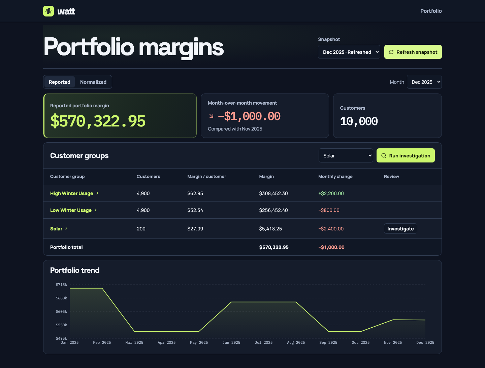

# Watt

**Watt helps retail electricity analysts explain why portfolio margins changed at month-end.** A workbook refresh shows the new total. Watt automates the work that follows by reconciling the change across customer groups, checking contract and settlement records, and producing a report the analyst can verify.

[Watch the prototype walkthrough (silent)](docs/evidence/demo.webm) · [Read the PRD](docs/prd.md) · [Run Watt locally](docs/local-setup.md)



## What the demo shows

1. **Refresh the portfolio.** Load December’s close for 10,000 synthetic customers. Overall margin fell **$1,000**, while the Solar group fell **$2,400**. The analyst can drill from the portfolio into a group, a contract, and its monthly margin components.
2. **Investigate Solar.** Codex checks the records and Watt shows progress as it works. The report traces **$1,200** to higher export credits and **$900** to a charge for November service posted in December. Another **$300** is tied to lower recorded imports, whose cause remains open.
3. **Decide what to do next.** The analyst can verify the settlement timing, bring the export-credit terms to pricing, and ask billing or operations to check the usage change. Within Watt, they can attach a dated record to the report, ask a follow-up, or compare a retention offer under explicit assumptions.

## How it works

A **Next.js** dashboard calls **FastAPI**, which queues each investigation for a **Python** worker. **PostgreSQL** calculates margins in exact cents and stores reporting snapshots, evidence, and run history. The **Codex SDK** gives the agent five read-only tools. Watt validates findings against evidence from the run and preserves verified findings when a run returns partial results.

The demo runs locally with fictional customers and contracts. Public market and weather sources are labeled separately. [Technical design and tradeoffs](docs/design.md) · [Implementation and verification history](PROGRESS.md)

## Try it locally

Use the [setup guide](docs/local-setup.md) to seed PostgreSQL, start the dashboard, and run a live investigation. The full demo uses Python 3.11+, Node.js 22+, Docker with Compose, `psql`, and a local Codex CLI signed in with ChatGPT.

To check the margin calculations from the repository root with Python alone:

```sh
python3 -m unittest discover -s tests -p test_finance.py -v
```
